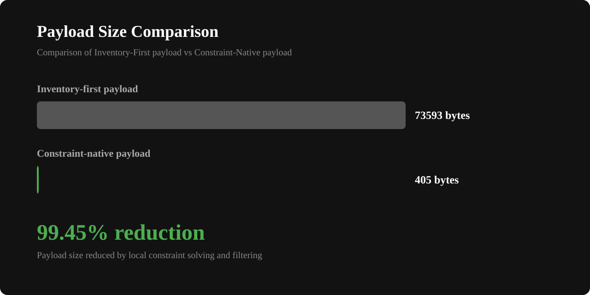
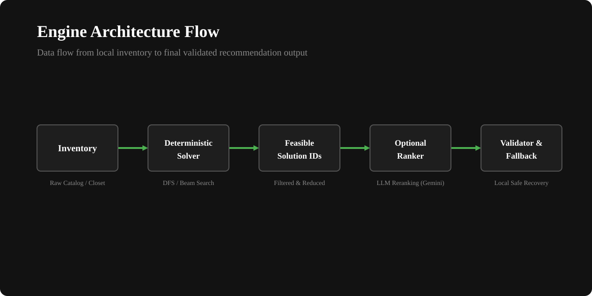

# Constraint-Native Generative Engine

[](LICENSE)
[]()
[]()

**LLMs rank feasible solution IDs. Deterministic code enforces every hard constraint.**

<!-- evidence:start -->
**Reduce LLM ranking context by 99.45%** on the bundled 500-item / 3-solution scenario, while independent verification reports **0 hard-constraint violations** and **0 accepted unknown IDs**.

[See the complete reproducible benchmark →](benchmark/reports/payload-evidence.md)
<!-- evidence:end -->



---

## Table of Contents

- [The Problem](#the-problem)
- [Quick Start (Offline Demo)](#quick-start-offline-demo)
- [Guarantees](#guarantees)
- [Architecture Overview](#architecture-overview)
- [Why JVM / Kotlin?](#why-jvm--kotlin)
- [Code Examples (Kotlin Usage)](#code-examples-kotlin-usage)
- [Optional Gemini Adapter (Generative Ranking)](#optional-gemini-adapter-generative-ranking)
- [Building and Running Benchmarks](#building-and-running-benchmarks)
- [Alpha Maturity & Roadmap](#alpha-maturity--roadmap)
- [Contribution, Security, and License](#contribution-security-and-license)

---

## The Problem

LLMs are inherently probabilistic and unreliable at strictly enforcing complex hard constraints — they can silently ignore rules buried in system prompts (such as "never pair item A with item B", "exclude laundry items", or "satisfy temperature layering rules"). Every failed LLM attempt requires retries that consume full context tokens and increase user latency.

**This engine flips the responsibility**: a fast, deterministic JVM solver enumerates only valid, feasible candidate assemblies *first*. The remote LLM is then invoked solely to rank among options that are already 100% guaranteed to satisfy all hard constraints.

---

## Quick Start (Offline Demo)

Execute the offline demo CLI with the following command:

```bash
# First run downloads Gradle & dependencies (~1-2 min)
./gradlew :examples:wardrobe-cli:run --args='--occasion formal --temperature 8 --diversityWeight 0.5'
```

Expected output snippet:
```text
====================================================
 Wardrobe Constraint Native Engine CLI
 Occasion: FORMAL
 Temperature: 8.0 °C
 Diversity Weight: 0.5
====================================================

Search Finished with termination: EXHAUSTIVE
Ranker status: NOT_CONFIGURED

Feasible Outfits Found: 5
```

> *Note: `Ranker status: NOT_CONFIGURED` confirms that the demo ran in 100% offline mode using local deterministic search without requiring an external LLM API key.*

---

## Guarantees

This engine provides the following mathematical and execution guarantees:
*   **Inventory Membership**: Every item included in a returned solution is guaranteed to exist in the original input candidate inventory.
*   **Slot Eligibility**: Assigned candidates are guaranteed to match the slot definitions and satisfy the specified slot requirements.
*   **Hard Constraints Compliance**: Every returned solution is guaranteed to satisfy all configured hard constraints. No violations can occur.
*   **Local Fallback**: A local deterministic fallback is guaranteed to execute immediately if the optional LLM ranker times out, fails validation, or experiences network transport errors.
*   **Zero External API Access in Core**: The core solving layer executes purely in local CPU memory without external API access, network connections, or telemetry tracking.

---

## Architecture Overview

The codebase is organized into modular JVM layers to enforce strict trust boundaries:



*   [`:engine-core`](engine-core): Contains type definitions and modeling interfaces.
*   [`:engine-solver`](engine-solver): Core exact backtracking search and level-by-level beam search solvers.
*   [`:engine-generative`](engine-generative): Orchestrator for local deterministic solving, validation, and remote ranking delegation.
*   [`:adapter-gemini`](adapter-gemini): Optional JSON adapter for the Gemini API.
*   [`:domain-fashion`](domain-fashion): Example implementation of wardrobe assembly with clothes matching rules.

For more details on modular security boundaries, see the [Architecture Documentation](docs/architecture.md).

---

## Why JVM / Kotlin?

*   **Type-Safety for Hard Constraints**: Domain rules (slot eligibility, temperature thresholds, color harmony, locked sets) are type-checked at compile-time.
*   **Fast Deterministic Local Search**: Backtracking DFS and beam search run in native JVM CPU memory in milliseconds without inter-process IPC overhead.
*   **Android & Server Ready**: Compiles to pure JVM bytecode (JDK 17+, Android API 26+) for offline mobile apps and backend services.

---

## Code Examples (Kotlin Usage)

### 1. Solver Initialization & Execution

```kotlin
import io.github.constraintnative.core.*
import io.github.constraintnative.solver.DeterministicSolver

val solver = DeterministicSolver()

val candidates = listOf(
    Candidate(
        id = CandidateId("t-shirt"),
        attributes = "Casual T-Shirt",
        eligibleSlots = setOf(SlotId("top"))
    ),
    Candidate(
        id = CandidateId("jeans"),
        attributes = "Blue Jeans",
        eligibleSlots = setOf(SlotId("bottom"))
    )
)

val slots = listOf(
    SlotRequirement(SlotId("top"), min = 1, max = 1),
    SlotRequirement(SlotId("bottom"), min = 1, max = 1)
)

val request = SolveRequest(
    candidates = candidates,
    slots = slots,
    context = Unit,
    hardConstraints = emptyList(),
    softScorers = emptyList(),
    desiredSolutions = 3,
    searchMode = SearchMode.EXACT,
    searchBudget = SearchBudget(maxExpandedNodes = 1000L, maxDurationMillis = 5000L, beamWidth = 10)
)

val result = solver.solve(request)
result.solutions.forEach { solution ->
    println("Solution ${solution.id.value}:")
    solution.assignments.forEach { println("  ${it.slot.value} = ${it.candidate.id.value}") }
}
```

### 2. Custom Hard Constraint Implementation

```kotlin
import io.github.constraintnative.core.*

class SpecificMatchConstraint(
    val slotA: SlotId,
    val slotB: SlotId
) : HardConstraint<String, Unit> {
    
    override fun evaluate(assembly: PartialAssembly<String>, context: Unit): ConstraintVerdict {
        val valA = assembly.assignments.find { it.slot == slotA }?.candidate?.id?.value
        val valB = assembly.assignments.find { it.slot == slotB }?.candidate?.id?.value
        
        if (valA == null || valB == null) {
            return ConstraintVerdict.Undetermined
        }
        
        return if (valA.takeLast(2) == valB.takeLast(2)) {
            ConstraintVerdict.Satisfied
        } else {
            ConstraintVerdict.Violated("suffix_mismatch", "Items did not match suffix")
        }
    }
}
```

---

## Optional Gemini Adapter (Generative Ranking)

For subjective and AI-assisted outfit selection, you can wrap the deterministic solver with the `GenerativeRanker` interface via the `:adapter-gemini` module.

The system translates the top deterministic candidate solutions into highly reduced ID-only arrays to run generative ranking. This mapping ensures that the LLM only observes valid options, keeping context size small and eliminating the threat of LLM hallucinations. The input contexts are formatted into escaped JSON structures.

See [Generative Ranking & Validation](docs/generative-ranking.md) for more details.

---

## Building and Running Benchmarks

We verify our performance claims using structured gradle tasks and microbenchmarks.

*   To run the test suite and verify evidence:
    ```bash
    ./gradlew :benchmark:verifyEvidence :benchmark:test dokkaHtmlMultiModule
    ```
*   To review the reproducible payload size report, see [Payload Evidence Report](benchmark/reports/payload-evidence.md).
*   For documentation on testing assumptions and metrics, see [Benchmark Methodology](docs/benchmark-methodology.md).

---

## Alpha Maturity & Roadmap

This library is currently in **Alpha maturity**. The API surface is subject to breaking changes.
*   **Current Limitations**: The search engines run on a single thread per request; large combinatorial state trees should utilize `SearchMode.BOUNDED_BEAM` search to restrict CPU overhead.
*   **Stability**: Backward compatibility guarantees do not apply until the 1.0.0 release.

### Roadmap
*   `[ ]` Python bindings (via JNI or gRPC sidecar) for LangChain, DSPy, and Python-native LLM pipelines.
*   `[ ]` Multi-threaded parallel beam search options.

---

## Contribution, Security, and License

*   **Contributions**: We welcome bug reports and code updates. Please read [CONTRIBUTING.md](CONTRIBUTING.md) for style rules.
*   **Security**: Please report security vulnerabilities or threat model reviews according to the guidelines in [SECURITY.md](SECURITY.md) and [docs/privacy-and-threat-model.md](docs/privacy-and-threat-model.md).
*   **Governance**: Community reviews and roadmap decisions follow [GOVERNANCE.md](GOVERNANCE.md).
*   **Code of Conduct**: Contributor interaction rules follow [CODE_OF_CONDUCT.md](CODE_OF_CONDUCT.md).
*   **License**: This project is licensed under the Apache License 2.0. See [LICENSE](LICENSE) for full details.
