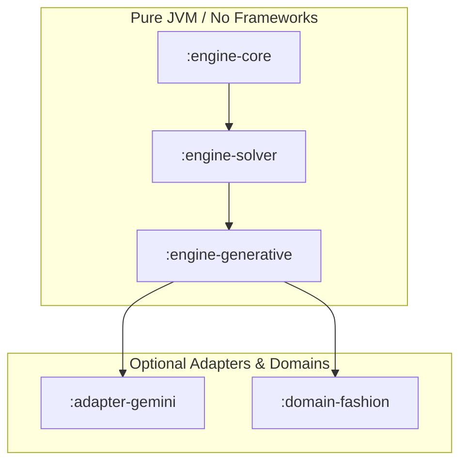

# Architecture

The Constraint-Native Generative Engine is structured to ensure that soft ranking (from LLMs or ML models) can never violate hard business constraints. This document details the system's modular boundaries, structured data flow, and pure JVM design.

---

## 1. Modular Trust Boundaries and Public API Overview

The project is split into five core Gradle modules to separate concerns and restrict access to remote services.



### `:engine-core`
*   **Purpose**: Declarations of the domain-independent core mathematical model.
*   **Public API**: 
    *   `Candidate` and `CandidateId` (identifiers and metadata attributes).
    *   `SlotRequirement` and `SlotId` (structure of the assembly template).
    *   `HardConstraint` and `ConstraintVerdict` (predicates for early-pruning search paths).
    *   `SoftScorer` (scoring functions for rating solution candidates).
    *   `SearchMode` and `SearchBudget` (execution parameters).
*   **Dependencies**: Zero external dependencies (only Kotlin Standard Library).
*   **Trust Boundary**: Fully trusted, static model layer. It performs no network/IO calls, has no external library references, and contains no state.

### `:engine-solver`
*   **Purpose**: Backtracking state-space exploration algorithms and local post-processors.
*   **Public API**:
    *   `DeterministicSolver`: The primary solving entrypoint.
    *   `SolutionCanonicalizer`: Combats structural permutations to ensure duplicate combinations are treated as a single unique solution.
    *   `DiversityReranker`: Optimizes the trade-off between quality scores and Jaccard-based diversity.
*   **Dependencies**: Depends strictly on `:engine-core`. No network, reflection, or framework dependencies.
*   **Trust Boundary**: Encapsulated algorithmic core. It is guarantees to terminate within `SearchBudget` limits.

### `:engine-generative`
*   **Purpose**: Coordinates deterministic solver executions with remote AI/LLM rerankers.
*   **Public API**:
    *   `ConstraintNativeEngine`: The orchestrator coordinating solve requests, ranking delegation, and local fallback behavior.
    *   `GenerativeRanker`: An interface for delegating ranking requests.
    *   `RankingValidator`: Implements stringent safety rules on outputs received from remote systems.
*   **Dependencies**: Depends on `:engine-core` and `:engine-solver`.
*   **Trust Boundary**: Defines the perimeter of trusted execution. It acts as a firewall between local deterministic constraints and untrusted remote generative content.

### `:adapter-gemini`
*   **Purpose**: Concrete implementation of `GenerativeRanker` targeting Google's Gemini LLMs.
*   **Public API**:
    *   `GeminiGenerativeRanker`: Formulates prompts and parses responses.
    *   `GeminiTransport`: An abstract interface delegating HTTP network transport to platform-specific clients (e.g. OkHttp, Ktor, or secure corporate proxies).
*   **Dependencies**: Depends on `:engine-generative`, and `kotlinx.serialization` for strict JSON schema enforcement.
*   **Trust Boundary**: Untrusted integration layer. It interfaces with the remote internet. It does not handle authentication directly; credentials/keys must be injected via the transport implementation.

### `:domain-fashion`
*   **Purpose**: A reference implementation demonstrating wardrobe outfits and clothes matching.
*   **Public API**:
    *   `FashionConstraints`: Weather compatibility, laundry status exclusions, locked-set item atomicity.
    *   `FashionScorers`: Occasion suitability, temperature comfort, color harmony.
*   **Dependencies**: Depends on `:engine-core`.
*   **Trust Boundary**: Domain-specific implementation. Completely deterministic.

---

## 2. Structured Data Flow

To eliminate prompt size bloat and protect the LLM from hallucinatory state-space generation, the engine routes data through a one-way pipeline:

```
[Catalog Inventory]
        │
        ▼
┌──────────────────────────────┐
│     Deterministic Solver     │
│  - Slot-eligibility filter   │
│  - Hard constraints pruning  │
│  - DFS / Bounded Beam Search │
└──────────────┬───────────────┘
               │
               ▼ [Canonical Solution IDs Only]
┌──────────────────────────────┐
│      Diversity Reranker      │
│  - Greedy Jaccard selection  │
└──────────────┬───────────────┘
               │
               ▼ [Top-K Solutions]
┌──────────────────────────────┐
│   Generative LLM Reranker    │
│  - Escaped ID-only JSON      │
└──────────────┬───────────────┘
               │
               ├──────────────────────┐
               ▼ (Valid Ranker Output)│ (Timeout / Injection / Invalid IDs)
┌──────────────────────────────┐      ▼
│       Strict Validator       │  ┌──────────────────────────────┐
│  - Hallucinated ID checks    │  │        Local Fallback        │
│  - Explanations length check │  │  - Preserve constraint state │
└──────────────┬───────────────┘  │  - Return deterministic order│
               │                  └──────────────┬───────────────┘
               │                                 │
               └───────────────┬─────────────────┘
                               │
                               ▼
                    [Final Recommendations]
```

1.  **Catalog Inventory Filter**: The raw list of items is matched against slot eligibility criteria.
2.  **Deterministic Solver**: The solver performs tree search (either exact depth-first search or level-by-level bounded beam search). It evaluates `HardConstraint` predicates at every path node to discard invalid subtrees early.
3.  **Canonical Solution IDs**: Outfits are canonicalized to prevent duplicates (e.g., swapping items between identical slots). The output is a list of feasible, unique solution combinations represented strictly by their identifiers.
4.  **Diversity Reranker**: A greedy Jaccard similarity selector identifies the top-$N$ most distinct solutions to maximize user options.
5.  **Generative LLM Reranking**: Instead of sending all inventory attributes and details, the engine sends only the top-$N$ solutions (as structured IDs) and a context prompt to the `GenerativeRanker`. This reduces payload sizes by up to 99%+.
6.  **Strict Validator**: The LLM's response is passed to the `RankingValidator` which verifies that:
    *   No unknown/hallucinated IDs are present.
    *   No duplicate IDs are returned.
    *   Text explanation fields do not exceed maximum character constraints or contain dangerous control characters.
7.  **Local Fallback on Failure**: If the LLM throws a transport error, times out, returns malformed JSON, or fails validation, the system discards the LLM's ranking and returns the deterministic local ranking, ensuring a 100% uptime guarantee.

---

## 3. Pure JVM Design

The core logic of the Constraint-Native Generative Engine is engineered as a framework-free JVM library.

*   **Zero Framework Dependencies**: No Spring Boot, Micronaut, Android SDK, or dependency injection frameworks are imported in `:engine-core`, `:engine-solver`, or `:engine-generative`. 
*   **Why?**:
    *   **Portability**: Can be imported into any backend JVM service, Kotlin Multiplatform server target, or local client application (such as Android devices).
    *   **Testability**: Unit tests run in milliseconds because there is no application context to boot.
    *   **Security**: Minimal external dependency footprint drastically decreases CVE vulnerability vectors.
